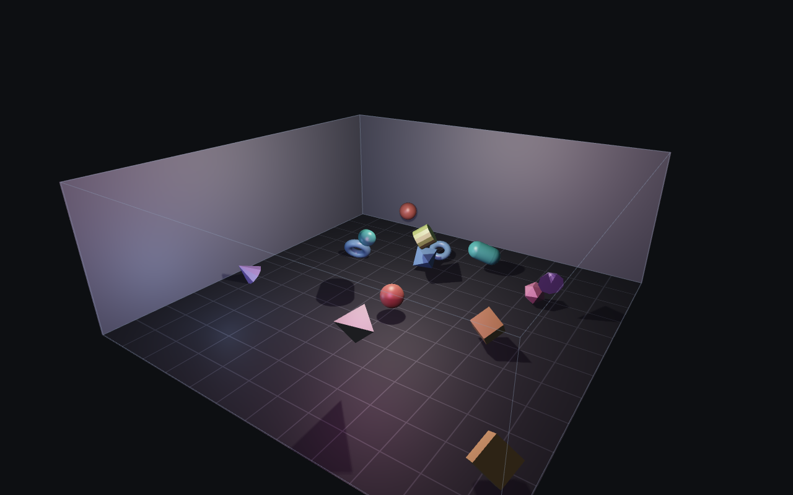
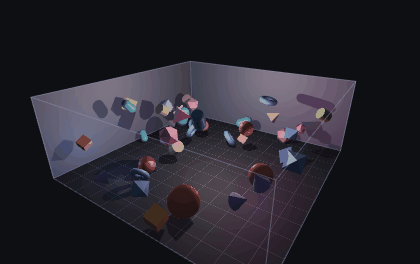
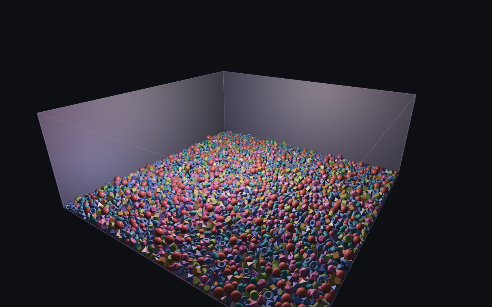
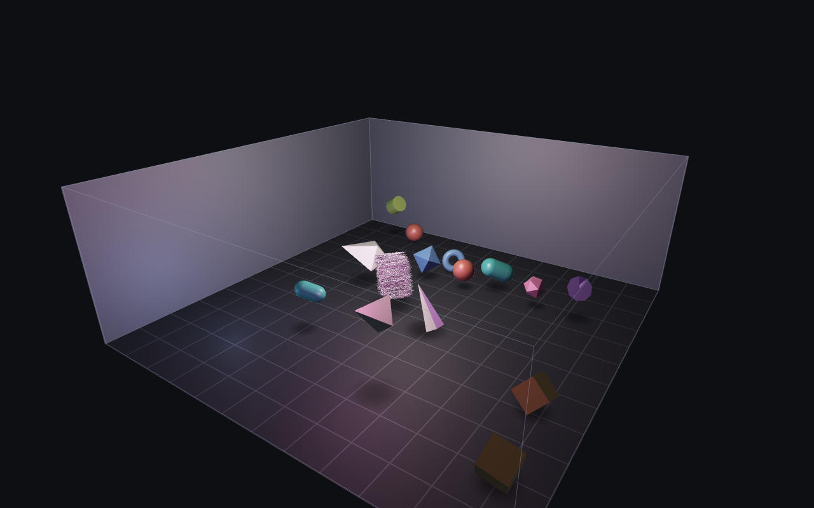
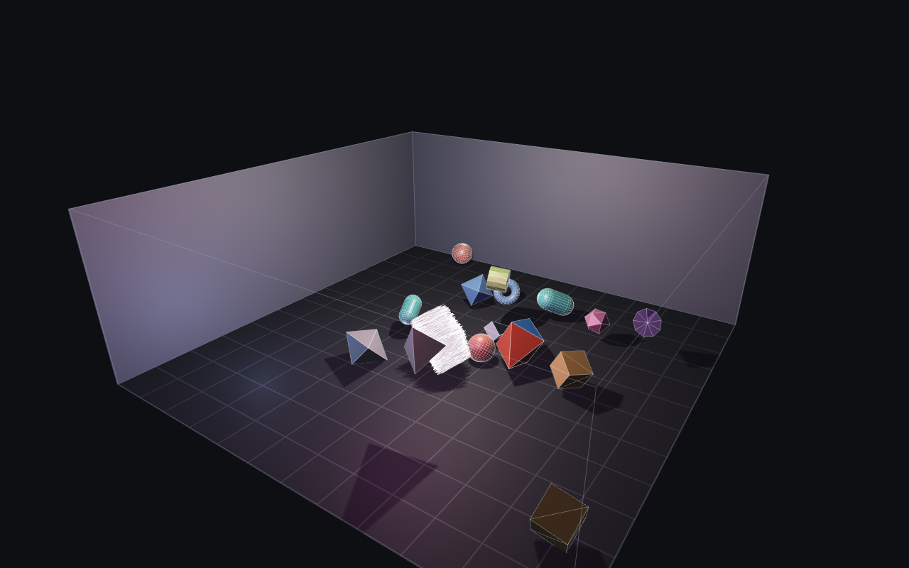

# Bouncing room — native

A room full of bouncing primitives, rendered natively in Rust with
[wgpu](https://wgpu.rs) (Metal on macOS, Vulkan on Linux) and controlled from an
[egui](https://github.com/emilk/egui) HUD. It is the native port of a
dependency-free WebGL app of the same name; the interface the port is written
against — vertex formats, bind-group layouts, lighting maths, the simulation
invariants — is [`docs/PORT_CONTRACT.md`](docs/PORT_CONTRACT.md).

## What it looks like



Nine primitives — sphere, cube, capsule, torus, cone, cylinder, icosahedron,
tetrahedron, octahedron — generated in code, tumbling and piling up under gravity.
The room's box is wound so that *front* faces are culled: orbiting outside gives a
cutaway, while a camera inside the room is fully enclosed. Three point lights do
the shading — a warm key in the ceiling fixture, a cool fill from a low corner, and
a coloured accent that orbits the room so the picture never quite settles — plus
hemispheric ambient, a rim term, and a floor grid drawn in the fragment shader
without screen-space derivatives. The key light casts real shadows, onto the
floor, the walls and the other bodies.



It goes past what the WebGL build did in a few directions:

- **Pick bodies up and throw them.** Click one to hold it, move the pointer,
  let go.
- **Rewind.** The last 900 frames are kept — fifteen seconds at 60 Hz; drag the
  slider back, or step backwards a frame at a time.
- **Thousands of bodies.** The count slider goes to 4000.
- **Real shadows, impact sparks, motion trails.**
- **Hull colliders.** Imported objects collide as their convex hull rather than
  as a ball, and the faceted primitives can too.
- **glTF**, with its material colours.
- **Collision sound.** Every hit is synthesised from the contact itself — harder is
  louder, smaller is higher — with a pentatonic pitch ladder so that two hundred bodies
  landing at once read as an instrument being played rather than as a swarm.
- **Record a clip** as an animated GIF, from the app or from the probe.

## Run it

```sh
cargo run --release              # the window
cargo test                       # 137 tests: units, fixtures, simulation invariants
cargo test -- --ignored          # + the one check that needs a real audio device
cargo run --bin probe -- --out probe.png    # headless render, then checks its own pixels
cargo run -- --help              # CLI flags, including --import, --record and --mute
```

It runs on macOS and Linux from the same source, with no platform-specific code in
`src/`. On Linux it needs a Vulkan driver, and opens its window on Wayland or X11,
whichever the session offers — and, since the sound is ALSA, two build-time packages
first: `sudo apt-get install -y libasound2-dev pkg-config`. The release workflow
installs them; a plain `cargo build` on a bare Linux box will not get past `alsa-sys`
until you do.

`--release` matters once the room is crowded: a debug build is fine for a few
dozen bodies and slow for a few thousand.

Tagging a version (`git tag v0.2.0 && git push origin v0.2.0`) runs
[`.github/workflows/release.yml`](.github/workflows/release.yml), which tests and
builds on Linux and macOS and attaches the binaries for Linux x86-64, Apple
silicon and Intel Macs to a GitHub release.

The probe is the interesting one. It renders a **seeded** scene offscreen, writes a
PNG, and then reads the picture back: every body's centre is projected into the
frame and compared against the same pixel from an otherwise identical *empty*
room. It requires exactly one room winding to show every body — both windings
passing would mean the room is not being culled at all, and neither passing would
mean nothing is being drawn. That winding is the one thing in this port that no
spec could decide, because WebGPU's framebuffer convention inverts GL's.

## Controls

| Input | Effect |
| --- | --- |
| click a body, drag, release | pick it up, carry it, throw it — it leaves with the speed the pointer had |
| scroll while holding a body | push it away or pull it closer along the pointer's ray |
| drag on empty room | orbit |
| right-drag | grab the room: slides the orbit centre, which is clamped inside the walls |
| scroll, pinch | dolly |
| `space` | pause / resume |
| `.` | frame-step: pauses, then advances exactly 1/60 s — two 1/120 substeps, so a scrubbed step is indistinguishable from a frame of a running sim |
| `,` | step *back* one frame; the rewind slider in the panel does the same by the handful |
| `k` | kick: a random impulse on every body |
| `r` | replay the generated room from the seed in the panel |
| `x` | clear every body, imported ones included |
| `w` | wireframe overlay |
| `c` | recenter the camera; leaves the auto-orbit setting alone |
| `h` | hide the whole HUD — for a clean picture; `h` again brings it back |
| `f` | full screen (the display's native mode) |
| `o` | open files in the system's own dialog |
| `v` | start or stop recording a clip |
| `s` | collision sound on or off; the panel also has a volume slider |

The panel carries sliders for gravity, bounce, simulation speed, body count (0
empties the room, 4000 fills it), air drag, wall grip, body grip and spin
coupling; a rewind slider; toggles for body-body collisions, hull colliders, sound,
wireframe, shadows, sparks, trails and auto-orbit; buttons for pause, step, kick,
reset, clear, spawn, record and re-seed; a picker for which of the nine
primitives the next spawn adds and how big it is; and a seed box.

**Rewind** keeps one snapshot per simulated frame — up to 900 of them, or 128 MB,
whichever runs out first, so a room of thousands remembers a few seconds rather
than fifteen (at 60 Hz). Scrubbing back pauses the room. Resuming plays on from where you
left it and discards what had followed; because the random generator's state is
part of each snapshot, playing on without touching anything repeats exactly what
happened the first time.



**A crowd** is made of smaller bodies: past 60, new bodies shrink with the cube
root of the count, which keeps the total volume roughly steady. Up to 64 bodies
every pair is tested in the order the WebGL build tested them, so a small room
behaves exactly as it always did; beyond that the pairs come from a spatial
grid, and all the bodies of one shape are a single instanced draw call. The room
above is 3000 bodies; three simulated seconds of it and the render take under a
second.

**Recording** writes an animated GIF, 640 pixels wide at 25 frames a second, of
the scene alone — no panel, whatever the window shows. It goes to `~/Videos`
(`~/Movies` on a Mac) if that exists, otherwise the working directory, and stops
by itself after 20 seconds. `--record 5` records five seconds from launch, prints
where the file went, and quits.

The four contact dials are worth a moment: `spin coupling` is what turns a sliding
body into a rolling one, and at 0 the room is effectively frictionless ice.

## Sound

Nothing is sampled. A hit is a few partials and a short noise burst, and every number
in it comes from the contact that made it: the closing speed sets how loud it is, the
contact radius sets the pitch (a boulder thuds at A1, a pebble pings two and a half
octaves up), the shape sets the timbre — a sphere is dull, a tetrahedron is a metallic
ping — and where along the room the contact happened sets the pan. There are no audio
files in this repository, and nothing to license.

Two things about it are design decisions rather than physics, and both are worth knowing
before you decide the sound is wrong:

- **Hits are short.** Nothing rings longer than a third of a second, and the biggest,
  dullest body in the room is only about two and a half times longer than the smallest —
  a voice that outlives its neighbours is what turns a roomful of impacts into a wash.
- **Pitches are snapped to a pentatonic ladder.** A settling pile reports a hundred and
  fifty contacts with a hundred and fifty slightly different natural pitches, which
  sounds like a bee-swarm; on a ladder the same pile sounds like something being played.
  The mapping stays monotonic, so harder is still louder and smaller is still higher.
- **A crowd is capped.** Four new hits per frame and fourteen in flight at once, and
  when the ceiling bites, the *loudest* are the ones kept. So in a 3000-body room you
  hear the significant impacts, not all of them, and the panel can say how many were
  turned away.

Clips are silent: a GIF has no audio track. On a machine with no output device the room
runs identically and the panel says why the silence is not a mute.

## Importing objects



Press **Open…** (or `o`) for the system file dialog, drag a file onto the window,
type its path into the panel, or pass `--import PATH` at startup. Read in this
process: **`.obj`** (Wavefront, through [`tobj`](https://crates.io/crates/tobj)),
**`.stl`** (binary and ASCII, parsed in-tree), and **`.gltf` / `.glb`** (glTF 2.0,
through [`gltf`](https://crates.io/crates/gltf)). Converted first, by an external
tool: **`.fbx`, `.blend`, `.usd`, `.usda`, `.usdc`, `.usdz`** — see below. Whatever
arrives, by whichever route, obeys four rules:

1. **One body per file.** A multi-object OBJ or a whole `.blend`-style assembly
   merges into a single mesh, because bodies collide as bounding spheres and
   splitting an assembly would let its parts bounce away from each other.
2. **Normalised to a unit bounding radius**, measured to the farthest vertex, so
   the file's units are never trusted — a cube authored in millimetres and one
   authored in kilometres import alike.
3. **Inside the renderer's 16-bit index budget.** Oversized meshes are welded (an
   STL writes one vertex per corner, which welds down by about 3x) and then have
   whole faces **sampled out at an even stride** rather than cut from the tail:
   files are written in spatially coherent order, so a tail-cut draws half an
   object while its collider still spans the whole thing.
4. **Given wireframe edges**, synthesised from the triangles, so the `w` overlay
   works for imports too.

Every repair and reduction is reported in the panel rather than applied silently.

**A glTF keeps its colours.** Each material's base colour, times any vertex
colours, becomes a colour per vertex, so a model with several materials arrives
in all of them — the red-and-blue gem in the picture is one mesh with two.
Roughness becomes the body's gloss, and every node's transform is applied before
the whole scene merges into one body. Textures are not kept: this renderer has no
texture coordinates, so a textured material is drawn in its flat base colour, and
the panel says so.

**Imports collide as convex hulls.** Each import gets a hull built from its own
vertices — the extreme points along 96 directions, so the vertex count is bounded
however large the mesh — and that hull, not a ball, is what meets the walls and
the other bodies. A spike lands on its side and a diamond on a facet. Contacts
against a hull act at the point of contact rather than along the line between
centres, so a hit off-centre turns the body as well as bouncing it. The same is
available for the cube, cone, cylinder and the three faceted solids, behind the
"for the faceted primitives too" checkbox; it is off by default because the
all-spheres model is the one the WebGL build had.

**The other six formats are converted, not parsed.** FBX is a binary AST with
mutually incompatible dialects, `.blend` is a self-describing blob whose layout
tracks Blender's own version, and USD is a *composition* system where the geometry
you see may be instanced, inherited across layers or refined from a proxy — so
"read the mesh" means implementing a resolver, and no maintained Rust reader exists
for any of them. Instead the app runs the file through Blender headless, which
writes a self-contained `.glb`, and hands that to the same glTF reader. `.fbx` falls
back to `assimp` when Blender cannot take it. Everything downstream — welding,
normalising, the index budget, edges, hulls — is the four rules above, and never
notices which route the bytes took. A `.usdz`, which is a zip archive this process
could not open by itself, arrives as geometry the same way.

That table is measured rather than assumed, and the measurements are the reason the
two recipes differ instead of one command line for everything. On Blender 5.0 the
importers are `bpy.ops.wm.fbx_import` and `bpy.ops.wm.usd_import`, and they have to
be called explicitly: `blender -b model.fbx` says "File format is not supported",
because FBX is an addon import and only the `.blend` loader gets handed a filename.
And `assimp export model.blend` fails with "BLENDER magic bytes are missing,
couldn't find GZIP header either" — its Blender loader predates the format Blender
2.8+ writes, which is why `.blend` has no fallback and `.fbx` does. The tests ask
Blender which operators it has instead of trusting the names in this file, because
`hasattr` and `.idname()` on `bpy.ops` will happily invent an operator for any
string you hand them.

A conversion costs seconds, so it runs on a worker thread and lands in a later
frame; the panel says *converting …* while it goes, rather than looking frozen.
**One file converts at a time**: drop ten `.fbx` files and you get ten waits in a row,
not ten Blenders at once — the start-up is the cost either way, and each of them holds a
scene's worth of memory while it runs. The panel says how many are queued behind the one
it is working on.
Nothing is installed behind your back: a machine with neither tool gets an error
that says so and names the `BLENDER` and `ASSIMP` variables that would point at
them. And a round trip through a converter is a re-export — whatever the source
carried that glTF cannot say is gone, and units, up-axis and materials are what the
converter decided. That goes in the import's notes rather than being left for you to
notice in the picture.

The image above is the same scene with `tests/fixtures/spike.obj`,
`diamond.stl`, `crumple.stl` and `two-tone.glb` added; the crumpled sheet is
24 200 facets, of which 12 100 were sampled out. In wireframe the sampling is visible for what it
is — a whole object, perforated, rather than half of one:



## Reproducing these pictures

All of them, the clip included, come from the headless probe, which is how these images can be
deterministic — a fixed seed, fixed simulated time, no window, no wall clock.
They are renders of the 3D scene, **not window captures**: none of them shows the
egui panel, which `h` hides in the live app anyway.

```sh
cargo run --bin probe -- --front-face ccw --width 1280 --height 800 \
    --count 14 --seconds 2.2 --out docs/screenshots/room
cargo run --bin probe -- --front-face ccw --width 1280 --height 800 \
    --count 12 --seconds 2.4 --out docs/screenshots/imported \
    --import tests/fixtures/spike.obj --import tests/fixtures/diamond.stl \
    --import tests/fixtures/crumple.stl --import tests/fixtures/two-tone.glb
# and again with --wireframe for the third
cargo run --release --bin probe -- --front-face ccw --width 1280 --height 800 \
    --count 3000 --seconds 3 --out docs/screenshots/crowd
cargo run --release --bin probe -- --front-face ccw --width 420 --height 264 \
    --count 40 --seconds 0.3 --primitive-hulls --gif 3 --out docs/screenshots/clip
```

The probe appends the winding to the name it is given (`room-ccw.png`), hence the
renaming. It prints the counts and every repair for each import as it reads them,
so the sampling above is visible in the output rather than only in the picture.

A converted format is worth checking the same way, because the file never enters this
process at all — Blender does, and the probe imports synchronously on purpose so that
this works headlessly:

```sh
blender -b --python-expr "import bpy; bpy.ops.mesh.primitive_cube_add(size=2); \
    bpy.ops.export_scene.fbx(filepath='/tmp/cube.fbx')"
cargo run --bin probe -- --front-face ccw --import /tmp/cube.fbx --out /tmp/converted
```

It prints which tool converted the file and what that tool decided, and its exit
status still means "exactly one room winding showed every body, this import
included".

## Where things live

| File | What it is |
| --- | --- |
| `src/geom.rs` | the nine primitives, the room box, and the helper quad and ring — all generated at startup |
| `src/sim.rs` | the physics: walls, pairs, contact-point friction, substepping, the grid broadphase, picking and snapshots |
| `src/hull.rs` | convex hulls: building one from a mesh, and its contact tests |
| `src/gfx.rs`, `src/gpu_types.rs` | instanced pipelines, the shadow cube, MSAA, offscreen capture, and the CPU/GPU structs they read |
| `shaders/*.wgsl` | lit, flat, line, trail and shadow shaders |
| `src/import.rs` | reading `.obj`, `.stl` and glTF into the shape list, and converting the six formats it cannot read |
| `src/effects.rs` | trails and sparks |
| `src/audio.rs` | collision sound: the mixer, the synthesis, and the caps that keep a crowd listable |
| `src/record.rs` | the GIF recorder |
| `src/app.rs`, `src/camera.rs` | the window, the HUD, the frame loop, the orbit camera |
| `src/bin/probe.rs` | the offscreen render and the pixel checks described above |
| `docs/PORT_CONTRACT.md` | the interface the port is written against |
| `tests/`, `tests/fixtures/` | the invariants, and real files to import |

## Limits worth knowing

- **Hulls are convex, and approximate.** A teapot collides as its convex hull, so
  nothing fits under its spout. The hull is built from extreme points along a
  fixed set of directions, which makes it very slightly smaller than the true
  one; and two hulls are tested on their face normals only, so a pair meeting
  edge to edge can touch a hair early. Bodies without a hull are still spheres,
  with the tuned radius factors (0.74–1.0) the WebGL build used.
- **Rotation treats every body as a ball.** Hull contacts turn a body using the
  moment of inertia of a solid sphere its size, not the body's own. It reads
  right; it is not a rigid-body engine.
- **Only glTF brings colour, and no format brings textures.** An OBJ's `mtllib`
  is dropped, and OBJ and STL imports cycle a small palette. A converted file keeps
  whatever colour the converter chose to write into the glTF, which is not necessarily
  what the source said.
- **Quitting during a conversion leaves the tool running.** It is not stopped: it runs to
  its 120 s ceiling after the window is gone, and its temporary directory is left behind.
  `x` (clear every body) does cancel what is queued and discards answers that come back,
  so the room stays empty — the leftover is process and disk, not geometry.
- **Six formats need a tool this app does not ship.** `.fbx`, `.blend`, `.usd`,
  `.usda`, `.usdc` and `.usdz` are converted by Blender (or assimp, for FBX only), so
  they work where one of those is installed and say so where neither is. `BLENDER` and
  `ASSIMP` point at non-standard installs. A cube costs about a second to convert
  here; nothing heavier was measured, and a conversion that outlives 120 s is stopped
  and reported rather than left running.
- **No up-axis or unit inference.** OBJ and STL carry neither, so the file's axes are
  kept as modelled: a Z-up CAD part lands on its side. For a converted file the
  converter decides instead — and the import's notes say that is what happened.
- **Four new sounds per frame, fourteen at once.** Beyond that the loudest wins, which
  is a decision about a 3000-body room rather than a limitation of the mixer: hearing
  every contact in a pile is not information, it is a rumble.
- **Sound is the one part no test can finish.** The mapping, the caps, the pan, the
  envelope and the sample-rate handling are all tested against a fake buffer with no
  device involved (18 of them), but whether it *sounds* right is not testable, no CI
  machine has an audio device, and the Linux build's ALSA dependency is only exercised by
  the release workflow, not locally here.
- **Trails cover the first 500 bodies.** Thousands of them are a blur, and they
  are rebuilt and uploaded every frame.
- **The six converted formats are checked on development machines, not in CI.**
  The release runners have neither Blender nor assimp, so the conversion tests skip
  there — out loud, in the test output — and `cargo test` says nothing about those
  formats. The check that proves the whole path, render included, is
  `cargo run --bin probe -- --import asset.fbx`.
- **No drag-and-drop under Wayland.** winit 0.30 delivers file drops on macOS and
  X11 only, so in a Wayland session a dropped file is ignored; use Open…, the
  path box or `--import`. Running with `WAYLAND_DISPLAY=` unset forces X11 (through XWayland),
  where dropping works.
- **The HUD is the only UI.** No menus; the file dialog is the system's own.
